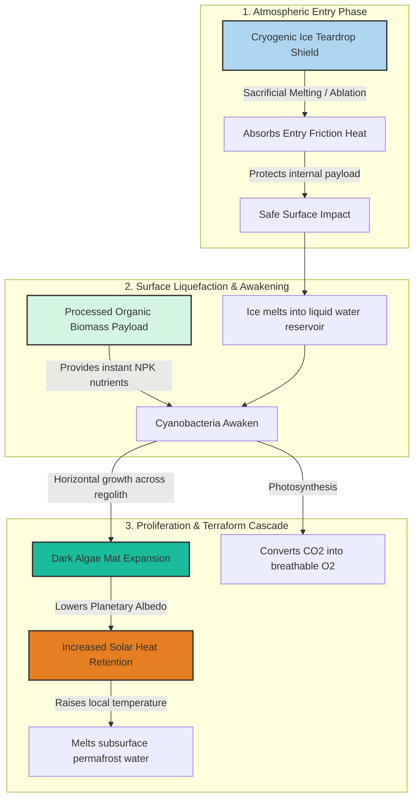

# 🪐 Project Aero-Seed: Future Design & Passive Terraforming Vector

This **Future Design** concept introduces an autonomous, zero-infrastructure atmospheric and soil terraforming framework for Mars. Utilizing biomimetic cryogenic "teardrop" capsules containing extremophile cyanobacteria within an organic nutrient matrix, the vectors melt upon landing to initiate a biological cascade that increases heat retention via Albedo modulation and triggers oxygen production.

## 🛠️ Biomimetic Entry & Biological Architecture

- **1. Aerodynamic Cryogenic Shell:** A seed-inspired ice teardrop acts as a sacrificial thermal ablation shield during Martian entry, protecting the biological payload without mechanical hardware.
- **2. The Dark Biological Core:** A dense colony of radiation-resistant *Cyanobacteria* (e.g., *Chroococcidiopsis*) lowers the local soil Albedo, absorbing solar radiation to raise surface temperatures.
- **3. Processed Biomass Substrate:** Encapsulated in circular organic waste biomass, providing an immediate NPK (Nitrogen, Phosphorus, Potassium) and trace element foundation for rapid multiplication in Martian regolith.

## 🔄 Passive Planetary Lifecycle

Deployed into Martian equatorial zones, the teardrops melt into liquid water to awaken the cyanobacteria. The algae spread horizontally, creating an Albedo feedback loop that warms the microclimate and unlocks permafrost, while photosynthesis consumes $CO_2$ and releases $O_2$.

## 📄 License

Licensed under the **MIT License** – Copyright (c) 2026 masakertsa.
